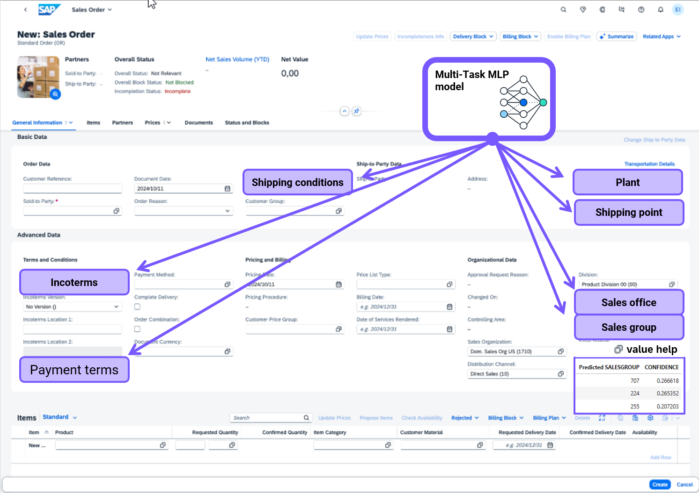
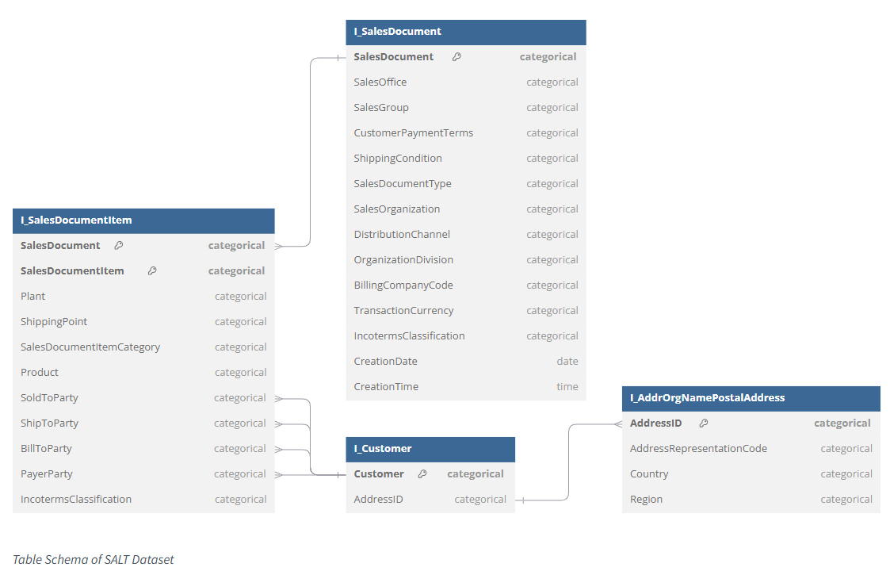

# Exercise 3 - Build multi-target neural network prediction models for an order form autocompletion use case

In this exercise, we will build a multi-target neural network machine learning model, using algorithms from the SAP HANA Cloud Predictive Analysis Library (PAL), so support a Sales Order form autocompletion use case, predicting 8 target field values at once. Providing the best 3 value proposals for each and measure the prediction accuracy.

## Exercise - Use case scenario overview

In a large variety of business processes, forms (like an Sales Order form) require filling a large number of fields in the UI. In data reality, some fields are often left blank when an order is created — for example, the shipping point, payment terms, or plant. Filling these in correctly requires experience and takes time.

In this exercise, you will build a __neural network machine learning model__ using algorithms from the __Predictive Analysis Library (PAL)__ in SAP HANA Cloud, to predict values to autocomplete 8 fields in a Sales Order form. The __PAL multi-target MLP algorithm__ in its latest release (2026 Q3), it also __allows to handle columns (fields), which are sometimes already filled and sometimes have to predicted, thus have a dual role__. Again, in reality a common pattern too.

*Example input screen of a Sales Order in SAP S/4HANA — the model shall predict the blank fields automatically.*

---
 

__The Sales Autocompletion Linked Business Tables (aka SALT) dataset__

The data used in this exercise comes from the **SALT** (Sales Autocompletion Linked Business Tables) dataset — a real enterprise dataset from an ERP system, designed to support machine learning research on tabular business data.

- The [SAP/SALT · Datasets at Hugging Face](https://huggingface.co/datasets/SAP/SALT) are composed of a set of CDS_VIEWS

Each record in the dataset is a SAP sales order with **27 fields** split into two groups:

| Group | Count | Examples |
|---|---|---|
| Always-known inputs | 19 | Sales org, product, sold-to party, billing country/region |
| Fields to predict | 8 | Sales office, sales group, plant, payment terms, incoterms, shipping condition, shipping point |

**Dataset reference:**

> Tassilo Klein, Clemens Biehl, Margarida Costa, Andre Sres, Jonas Kolk, Johannes Hoffart.
> *SALT: Sales Autocompletion Linked Business Tables Dataset.*
> NeurIPS 2024 Third Table Representation Learning Workshop.
> https://openreview.net/forum?id=UZbELpkWIr

  

## Start the exercise
- Open the notebook file __ex03_notebook.ipynb__ from the project explorer
  
   

- Select the Python Kernel
 
   

- Select the prepared __.venv-DA262__ Python Kernel
 
   

- Next, to pursue the exercise, execute the cells step by step, by clicking the __run cell-icon ">"__ as highlighted
 

Proceed through the exercise sections and run the cells from top to bottom.

    

The following exercise descriptions, just give a high-level exercise overview, all the instructions and explanations are part of the notebook file __ex03_notebook.ipynb__ itself.

## Ex. 3.0 - Connect to your SAP HANA Cloud instance
- The outline-view on the lower left in Visual Studio code, overviews the exercise sections and steps 
 

- In __Step 0__ you first create the connection to SAP HANA Cloud, and shows successful message like
 

## Ex. 3.1 - Access and Explore the sales order data
- Steps in this exercise section 
 

- In __Step 1__ you will create a HANA dataframe against the preloaded tables
 

    This step creates **HANA DataFrames**, which are SQL select statement pointers to tables that already live inside SAP HANA Cloud. 

    You will work with:
    - **Training set** — 1.9 million past orders, used to train the model
    - **Test set** — 1,000 orders the model has never seen, used to measure accuracy

 

- In Step 2 you will use different HANA dataframe methods to overview and explore the Sales Order data, like the target column value distribution
 

    In more detail you will:
    - **Preview a few rows** — see what a real sales order looks like
    - **Count unique values per field** — fields with more unique values are harder to predict. For example, SALESOFFICE has only 4 possible values (easy), while SALESGROUP has 260 possible values (harder). You will see this difference clearly in the accuracy results.
    - **Run a statistical summary** — check for nulls, min and max values, and data quality
  

## Ex. 3.2 - Train a "multi-target" classification model for sales order form autocompletion
- Steps in this exercise section 
 
 

- In __Step 3__ you access the pre-trained MT_MLP model and explore statistics from its training task
  - The model is a **Multi-Task MLP** (Multi-Layer Perceptron — a type of neural network). "Multi-Task" means it predicts all 8 missing fields at the same time in a single pass, rather than running 8 separate models. This makes it faster and lets the fields help each other during prediction.
  - The SALT training data set has ~1.9 million rows, training a model from scratch might takes more than an hour, therefore we re-use a pre-trained model based on 1.9 million rows and finetune that in the next steps
  
 

- In __Step 4__ you will create a HANA dataframe for the fintuning data and overview the MT_MLP Neural Network parameters used to train the model
 

- In __Step 5__ you will define and execute the model finetuning-fit task and create an even better prediction data based on the new Sales Order data
 
 
  

## Ex. 3.3 - Predict missing fields to autocomplete new sales orders
- Steps in this exercise section 
 
 

- In __Step 6__ we will apply the model for prediction to new Sales Orders (actually data rows from our test data)
  - We will sample 4 orders from the test set
  - A "speciality" of the algorithm is, it can handle column in dual role, as features as well as target columns, depending on what is present in each row individually. However, for the model to detect if a rows value a column should be treated as target, the empty / missing value needs be replaced with a special marker value  `PAL_MLP_MASK` (or `999` for integer columns).
  - See the replacement excample for the column SALESOFFICE
   
   

  - the __predict__-call applies the model and we can compare predicted against some actual values for an accuracy impression
     

    The model looks at the 19 known input fields (product, customer, country, etc.) and predicts all 8 blank fields at once. Because we already know the true values for these 4 orders, we can immediately check whether the predictions are correct.

    The result table shows each order, each field, the true value, the predicted value, and whether they match.
  

## Ex 3.4 - Measure prediction accuracy
- Steps in this exercise section 
 
 

- In __Step 7__ we want to measure the models prediction accuracy over **1,000 orders** from the test data set to get more reliable accuracy numbers.

    The model does not just give one answer — it can give us an prediction confidence for all possible prediction values of a target column. Here we want the **top 3 predicted values** ranked by confidence for each target.
  - As and example, we measure the accuracy using three metrics for the SALESGROUP field:
   
    - **Top-1 = 90.7%** The model's first guess was correct for 907 out of 1,000 orders.
    - **Top-3 = 99.1%** The correct answer appeared somewhere in the top 3 guesses for 991 out of 1,000 orders. The model got it wrong on first guess 93 times, but the right answer was still in the top 3 for 84 of those 93 times.
    - **MRR = 0.949** MRR measures how highly the correct answer is ranked on average:
        - If the correct answer is always rank 1 → MRR = 1.000 (perfect)
        - If the correct answer is always rank 2 → MRR = 0.500
        - If the correct answer is always rank 3 → MRR = 0.333
        - MRR = 0.949 means the correct answer is almost always the model's first guess — very close to perfect.

    **Why Top-3 matters in practice:** In a real SAP applications, the user sees a dropdown with the top 3 suggestions and picks the right one. A Top-3 score of 99% means the correct answer is in the dropdown almost every time.  

    Within an application the prediction **confidence scores** might of crucial help to the end-user, when confidence is high to accept the auto-filled values, and when it is low, the application can ask the user to confirm.

  

## Summary

In this exercise you used a machine learning model from the Predictive Analysis Library (PAL) to automatically predict 8 missing fields on SAP sales orders — executing entirely inside SAP HANA Cloud, without moving any data to Python.
- **ML inside SAP HANA Cloud**  The model runs where the data lives — no export, no extra infrastructure 
- **Pre-trained model** Training took 2.5 hours once; after that predictions take milliseconds (especially with stateful models)
- **Multi-target model with dual-roal attributes** MT_MLP is a powerful neural network algorithm, allowing to use of overlapping attributes in complex order form autocompletion scenarios

  
---
Continue to - [Exercise 4 - Build a service ticket intelligence classification model using AutoML and raw text features](exercises/ex4/)

  

  

## Appendix - Option
### Improve prediction latency with stateful models (optional)

The model is accurate. Now the goal is to make it **production-ready**.

**The problem with standard predict:** Every time a prediction runs, SAP HANA loads the full model from disk into memory, runs the prediction, then removes the model from memory. For a model with 14,864 rows of weights, this disk-load step takes hundreds of milliseconds — too slow for real-time order processing.

**The solution — Stateful Predict:** Load the model into HANA server memory **once**, keep it there, and reuse it for every prediction. The model stays in memory between calls, so each prediction only does the actual computation — no disk loading.

This section proves two things with real numbers:
1. **Accuracy** — stateful predict gives exactly the same results as standard predict
2. **Speed** — stateful predict is approximately **10x faster** per order

| Mode | Speed | Orders per minute |
|---|---|---|
| Standard predict | ~600 ms per order | ~100 orders/min |
| Stateful predict | ~60 ms per order | ~1,000 orders/min |

  
